<p align="center">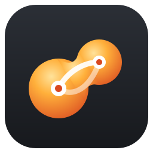</p>

# Syntexophobic

Parametric CAD and 2.5D CAM for GRBL machines (Shapeoko, Nomad, Carbide Motion), with a
git-style history instead of a timeline. Built on OpenCascade, Qt and VTK. Linux, macOS and Windows.

*σύντηξις (sýntēxis): melting together, fusion.*

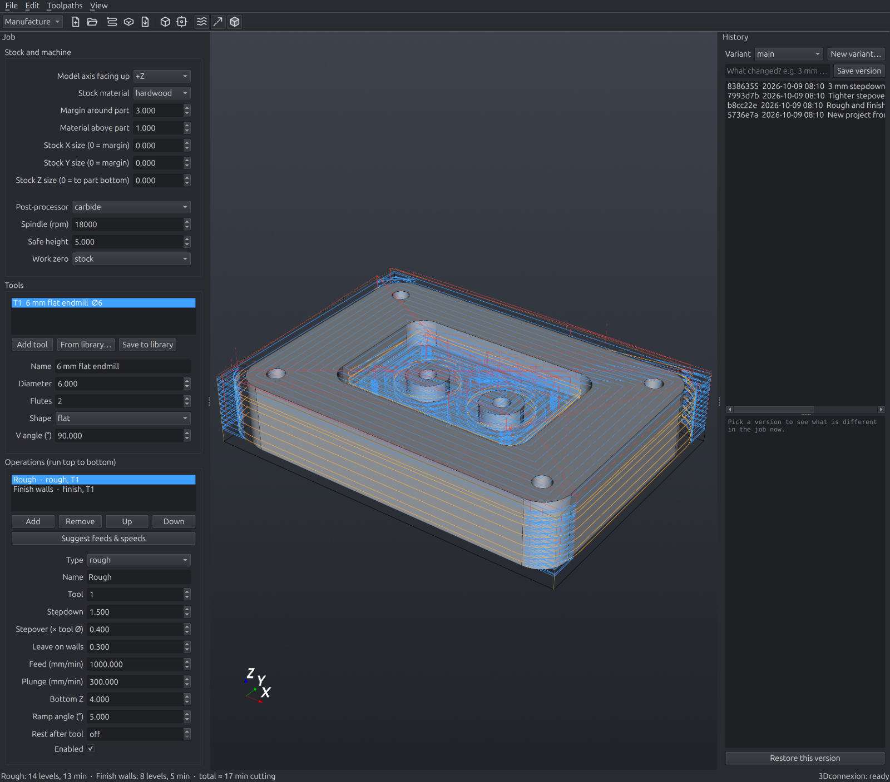

## Install

**One file:** download `Syntexophobic-<version>-x86_64.AppImage`, then

```sh
chmod +x Syntexophobic-*-x86_64.AppImage
./Syntexophobic-*-x86_64.AppImage              # the window; add a path or a command as below
./Syntexophobic-*-x86_64.AppImage install-mcp  # optional: let Claude Code drive it
```

It carries its own Python and libraries (x86-64 Linux; the window needs X11 or XWayland).
Build it from a clone with `./tools/build-appimage.sh` (writes `dist/`).

**On a Mac** (Apple silicon, macOS 12 or later): download `Syntexophobic-<version>-macOS-arm64.zip`,
open it and move *Syntexophobic* to Applications. It is not signed by Apple, so the first
start says macOS cannot check it: System Settings → Privacy & Security → *Open Anyway*
(or `xattr -dr com.apple.quarantine /Applications/Syntexophobic.app`). For Claude Code:
`/Applications/Syntexophobic.app/Contents/MacOS/Syntexophobic install-mcp`. Build it on a Mac
with `./tools/build-macos.sh`.

**On Windows** (x64): download `Syntexophobic-<version>-windows-x64.msi` and run it. It installs
for you alone, in `%LOCALAPPDATA%\Programs\Syntexophobic`, so it needs no administrator, and adds
a Start menu entry and an uninstall entry under Settings → Apps. It is not signed, so SmartScreen
asks first (*More info* → *Run anyway*), and a managed work PC may refuse it. Or download
`Syntexophobic-<version>-windows-x64.zip`, unpack it and run `Syntexophobic\Syntexophobic.exe`.
Either carries its own Python and git. For Claude Code: `Syntexophobic.exe install-mcp`. Build
both on Windows in Git Bash with `./tools/build-windows.sh` (needs WiX 5 for the installer). In
the installed copy, *Update* in the update bar downloads the new installer and runs it when
Syntexophobic restarts; the unpacked zip says where to download it.

**Releases** are built by GitHub Actions: pushing a version tag (`git tag v0.6.3 && git push
origin v0.6.3`, after the version in `pyproject.toml` and a `## v0.6.3` section in
`CHANGELOG.md`) builds the AppImage with its `.blocks` file, the macOS app and the Windows build, tries each,
and publishes them as the release, with that CHANGELOG section as its notes. Or, without a
tag: Actions → *Release* → *Run workflow* with *publish* ticked releases the version in
`pyproject.toml` and makes its tag.

**Updates:** when a newer release is on GitHub, a bar above the view says so, with what's new.
In the AppImage, *Update* downloads the new one next to it and points
`~/Applications/Syntexophobic.AppImage` (the link a menu entry should start) at it. In the
macOS app, it downloads the new app and puts it in the old one's place (the old one is kept
in `~/Library/Caches/syntexophobic/previous`). It
downloads only what changed when the release also has the `.AppImage.blocks` file that
`./tools/build-appimage.sh` writes next to the AppImage (attach both). The
repository is private, so the check uses your GitHub login: `gh auth login`, `GH_TOKEN`, or
the token git keeps for github.com. Without one it stays quiet; Help → *Check for updates…*
says why.

**As a Python tool** (not an npm package), with [uv](https://docs.astral.sh/uv/):

```sh
uv tool install git+https://github.com/phobicdotno/syntexophobic   # installs the `syntexophobic` command
uv tool upgrade syntexophobic                                      # later: update
```

`pipx install git+https://github.com/phobicdotno/syntexophobic` works too. From a clone, put
`uv run` in front of the commands below.

## Run

```sh
uv run syntexophobic                         # open the window
uv run syntexophobic part.step               # new project from a STEP, STL or 3MF file and open it
uv run syntexophobic new part.step [x.cccp]  # create a project only (a .cccp file or a folder)
uv run syntexophobic convert part.stl [out.step]  # STL mesh -> STEP solid
uv run syntexophobic --version               # version and build (Help > About lists every release)
uv run syntexophobic gcode <project>         # write G-code without the window
uv run syntexophobic simulate <project>      # simulate; exits 1 if the tool would gouge the part
uv run syntexophobic backends                # compute backends and devices
./tools/install-desktop.sh                   # add it to the app menu
uv run pytest                                # tests
uv run python tools/mutants.py               # check the safety tests catch known bugs
```

## Claude

Syntexophobic can be driven entirely by Claude, using your Claude subscription through
Claude Code (no API key):

- **In the program**: View > Assistant (Ctrl+K) opens a chat panel. Claude gets only
  Syntexophobic's tools and you watch the window change as it works. Paste a picture or a
  link (Ctrl+V), attach one or take a photo; a picture or shop link of a router bit adds
  it to your tool library, in the size you say you have.
- **From Claude Code**: `uv run syntexophobic install-mcp` registers the MCP server once;
  then any Claude Code session can design, machine, simulate and export. With the window
  open, changes appear in it live; without it, Claude works on the project files.

The MCP server has 45 tools (projects, parameters, sketches, features, stock, tools, tool
library, operations, toolpaths, simulation, G-code, slicing for laser / CNC sheets, history,
views, screenshots, problem reports).
Claude is told to call nothing safe to run until `simulate` says so.

**Fault reports:** when a tool fails in the Assistant panel, or Claude can't do what you
asked, the program files a GitHub issue (label `fault-report`) with the version, OS, your
request, every tool call and its result, Claude's answer, a screenshot and the log tail
(`~/.cache/syntexophobic/syntexophobic.log`); the chat links it. The same fault again is
added to the open issue. It uses your GitHub login (`gh auth login`, `GH_TOKEN`, or the token
git keeps); without one nothing is sent. `SYNTEXOPHOBIC_NO_FAULT_REPORTS=1` turns it off.

**Error reports:** every other error while you use the program goes there too: exceptions,
logged errors, error and warning dialogs, Qt errors and a crash of the last run, each with
the version, OS, traceback, open project and the log of what you did before it (label
`app-error`). A repeat is a comment on its open issue, sent once per run and at most once a
day after that, with the count in between; at most 20 reports per run. Help → *Send error
reports automatically* turns it off.

## How it works

A **project** is a folder with the model (a designed part or a STEP file), `job.toml` and a
git repository. The toolbar switches between the **Design** and **Manufacture** workspaces.

To model a part, press **New design** (the pencil, Ctrl+Shift+N). To work on a STEP or STL
part, open it as a project and press **Design on this part** in the Design workspace: the
model becomes an Import feature you can add sketches, cuts, holes and fillets to.
Meshes (STL, 3MF) come in as solids: triangles in one plane merge into one flat face, and
faceted holes and round bosses become true cylinders.

### Design

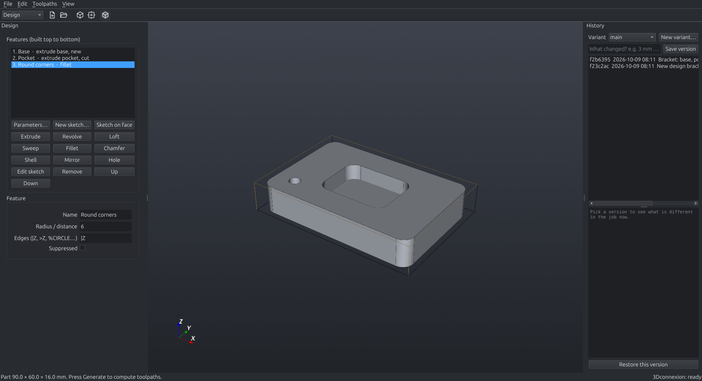

A part is a list of features in `model.toml`, built top to bottom. A "new" feature starts a
separate body (a box and its lid in one design); others change the body you name, and a cut
without one goes through all of them.

| Feature | Options |
|---|---|
| **Extrude** | distance, symmetric, new / join / cut / intersect, linear or circular pattern |
| **Revolve** | axis line from the sketch, angle, same operations and patterns |
| **Loft** | through two or more sketch profiles, bottom to top |
| **Sweep** | a profile along a path sketch of lines and arcs |
| **Fillet**, **Chamfer** | radius or distance, edge selector |
| **Shell** | wall thickness, faces to open |
| **Mirror** | YZ, XZ or XY plane |
| **Hole** | simple, counterbore or countersink on every free point of a sketch, blind or through |
| **Relief** | a picture's brightness as height, on a base slab |
| **Import** | a STEP or STL part (copied into `imports/`) as a body: new, join, cut or intersect |

**Parameters** (`width = 80`, `wall = 2.5`, `depth = width / 4 - wall`) can be used in
sketch dimensions and in feature values; change one and the whole part follows.

Edges and faces are picked by clicking them in the 3D view (stored as `@x,y,z` and found
again after a rebuild), or with short selectors: `|Z` (vertical edges), `#Z` (horizontal),
`>Z` / `<Z` (top / bottom face), `%LINE`, `%CIRCLE`, and `A&B` for both. Click a flat face
(slanted ones too) and press *Sketch on face* to draw on it.

### Sketch

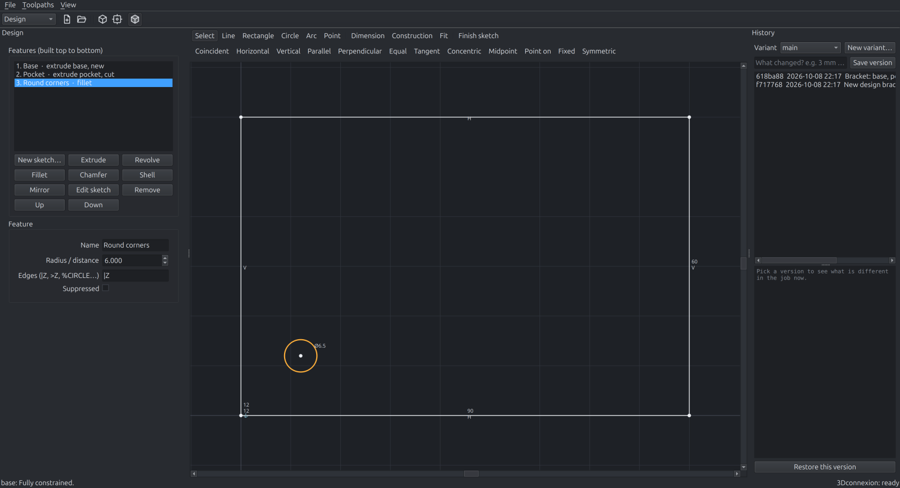

Lines, rectangles, circles, arcs, splines, polygons, slots, text and points on the XY, XZ or YZ
plane (with an offset), or on any flat face of the part. Text comes as outlines in any
installed font (to extrude or V-carve) or as single-line Hershey lettering (to engrave: each
stroke is cut once). Corner fillet, offset, mirror and trim work on existing geometry.
Clicking near a point reuses it. Constraints: coincident, horizontal, vertical, parallel,
perpendicular, equal, tangent, concentric, midpoint, point on line/circle, fixed,
symmetric, plus dimensions for length, distance, diameter and angle. Geometry is blue while
it can still move and white when fully constrained; conflicting constraints turn red.
Sketches live in `sketches/<name>.toml`. DXF drawings import as sketches (File menu) and
sketches export as DXF; designed parts export as STEP or STL.

### Job

Stock, machine, tools and operations live in `job.toml`: plain text, stable key order, one
value per line, so diffs read well. Edits in the window are written straight to it.

### History

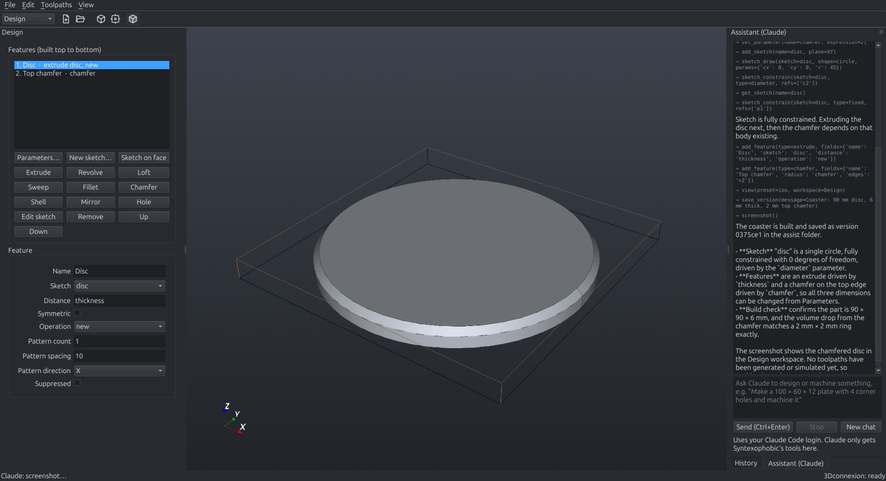

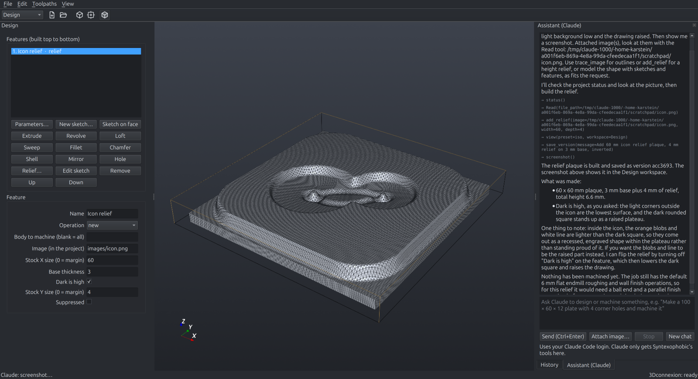

Pictures can become geometry: *Trace image* turns a logo into sketch outlines, *Relief*
turns brightness into height, and the Assistant's *Attach image* lets Claude design a 3D
figure from a picture.

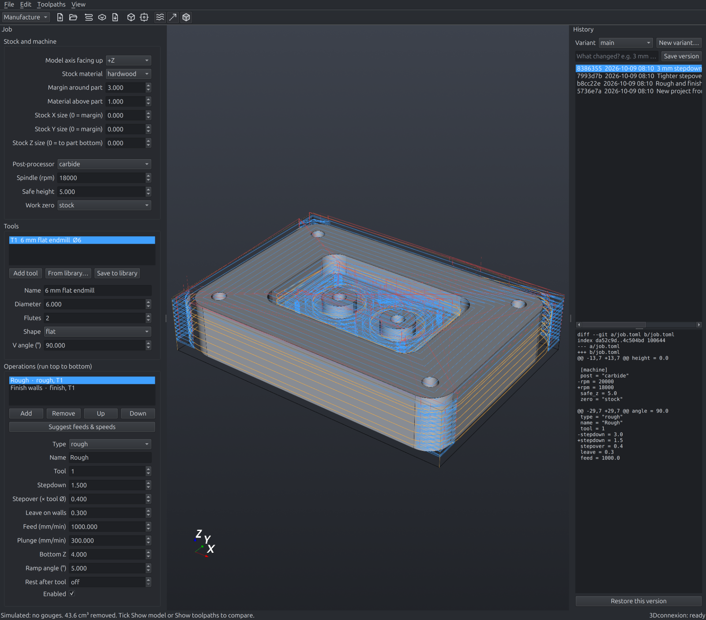

- **Save version** makes a git commit with your note.
- **Variants** are git branches, for trying another tool or strategy without losing the original.
- Picking a version shows what differs in the job now; **Restore** brings it back as unsaved changes.
- The **Subway** tab draws every variant as a coloured line and every version as a station;
  hover a station to see what that version changed.
- `git log` in the project folder shows the same history.

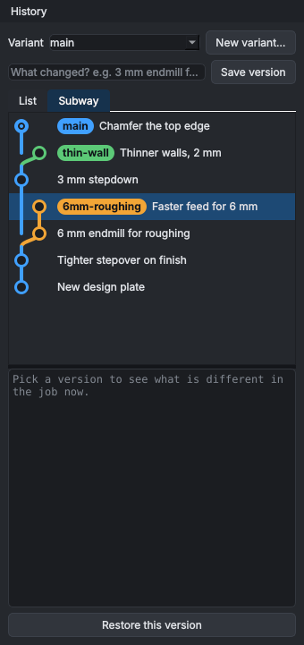

### Export

- **File > Export model…**: STEP, IGES, BREP (exact solids) or STL, OBJ, PLY, glTF and 3MF
  (meshes), by the file's extension.
- **File > Export sketch…**: DXF, SVG, PDF, EPS or HPGL, 1:1 in millimetres.

### Slice for laser / CNC

**Slice** (Design ribbon, Fabricate; Manufacture ribbon, Sheets; or File > Slice for laser /
CNC…) cuts the model into flat parts to cut from sheet wood or acrylic and put back together:

| Style | How it goes together |
|---|---|
| Stacked layers | Horizontal layers one sheet thick, glued. Dowel holes line them up; each layer has where its neighbour goes engraved on it. |
| Slices on a rod | Slices threaded on a rod or pipe, with spacer rings cut from the same sheet. A slice the rod misses gets a hub. |
| Slices on a base plate | Upright slices with tabs in slots of a base plate, numbered on the plate. |
| Slices on a back plate | The same against a back plate, to hang on a wall. |
| Waffle | Two sets of upright slices at right angles, slotted half way so they slide together. |

Choose the sheet thickness, the spacing or number of slices, the play in slots and holes,
and laser (kerf compensation) or CNC router (dogbones in the inside corners for the bit).
The 3D view shows the assembled slices while the window is open, and the sheets are drawn
beside the settings. **Export sheets…** writes one DXF and one SVG per sheet: cuts red on
layer CUT, part names and guides blue on layer ENGRAVE, packed onto the sheet size you set.

### Project files (.cccp)

A project is kept in one `.cccp` file: a zip of the project folder (`job.toml`, `model.toml`,
`sketches/`, imported models) together with its `.git` folder, so every saved version and
variant travels with it. Its first entry is an uncompressed `mimetype`
(`application/x-syntexophobic-project`), as in OpenDocument files.

The window works on an unpacked copy in the cache folder and writes the `.cccp` back on every
saved version, shortly after each edit and on close. Unzip one and you have an ordinary
project folder. Every saved version also writes the finished part into `final/`
(`part.stl` as machined, `drawing.svg` with every sketch, `info.json`), kept out of the history:
programs that only want the result, such as phobiCCCP, read just that. Old project folders still open (pick their `job.toml`), and
**File > Save project as…** moves one into a `.cccp`.

### Toolpaths

For each Z level the tool may not enter anywhere the part exists at or above that height.
That area, grown by the tool radius (plus *leave*), is cut out of the stock outline.

| Operation | What it does |
|---|---|
| **rough** | clears everything left with concentric offset rings |
| **adaptive** | clears with a steered tool that keeps the cut near the stepover (no slotting), for deep passes |
| **finish** | follows every wall once per level; with a ball end it is waterline finishing for steep 3D walls |
| **profile** | follows only the outermost silhouette, for cut-outs; supports **tabs** |
| **parallel** | 3D finishing: raster passes riding on the surface (exact drop-cutter, flat or ball end) |
| **vcarve** | V-bit carving of a sketch or DXF (text, logos): sharp V walls, flat floors past a max depth |
| **engrave** | the tool's centre on a sketch's or DXF's lines (open lines too), down to a depth in stepdown passes |

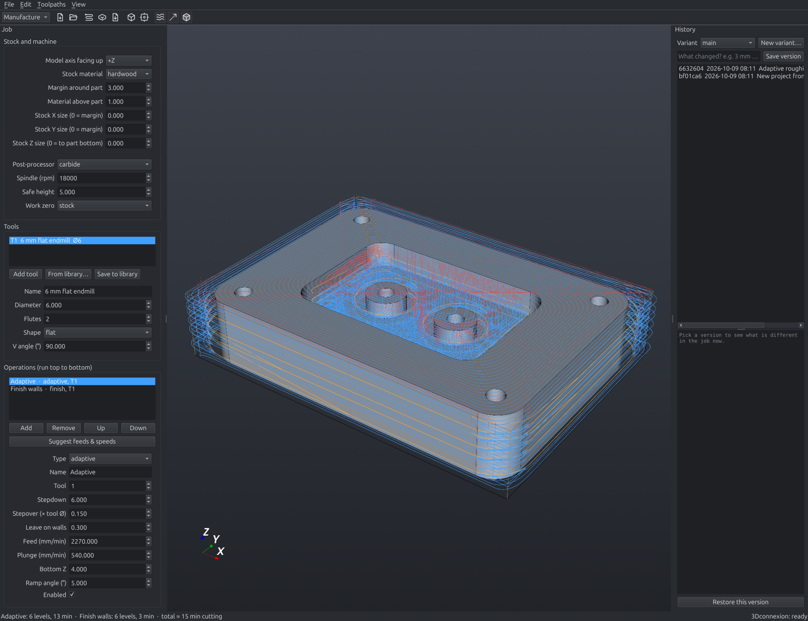

- Levels always land exactly on flat floors found in the model.
- Every pass **ramps** down along its own path (default 5°) instead of plunging.
- Tabs step straight up just before and down just after, so no slanted move nicks them.
- The model is sliced as a 0.01 mm mesh, checked against exact OpenCascade sections; any
  outline that does not close falls back to the exact section.

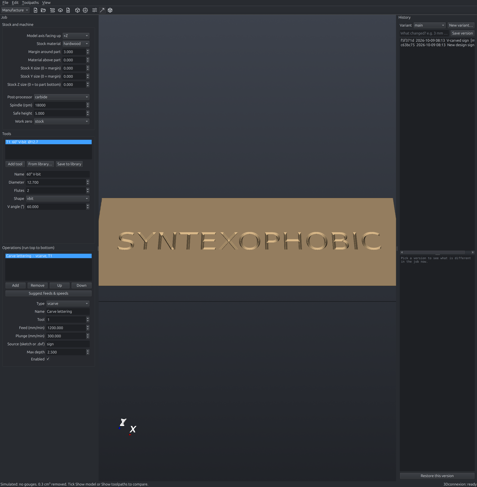

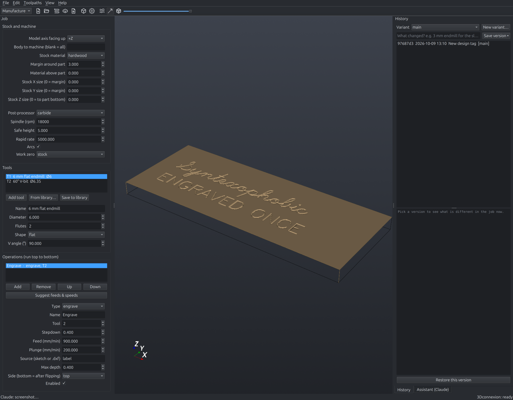

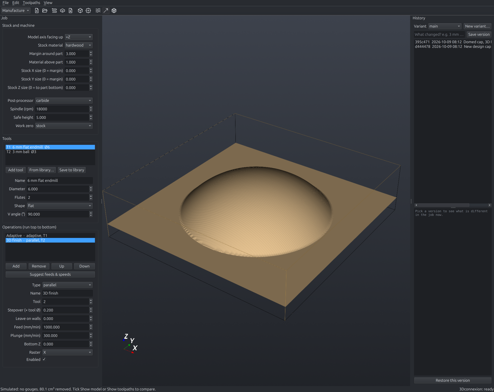

### Two sides

Give an operation `side = "bottom"` to machine the part after turning it over (about the
X axis, front edge staying at the front). Export writes `name-top.nc` and
`name-bottom.nc`; the simulation follows both faces of the stock, so pockets on each
side and holes drilled through from below are checked like everything else.

### Simulation

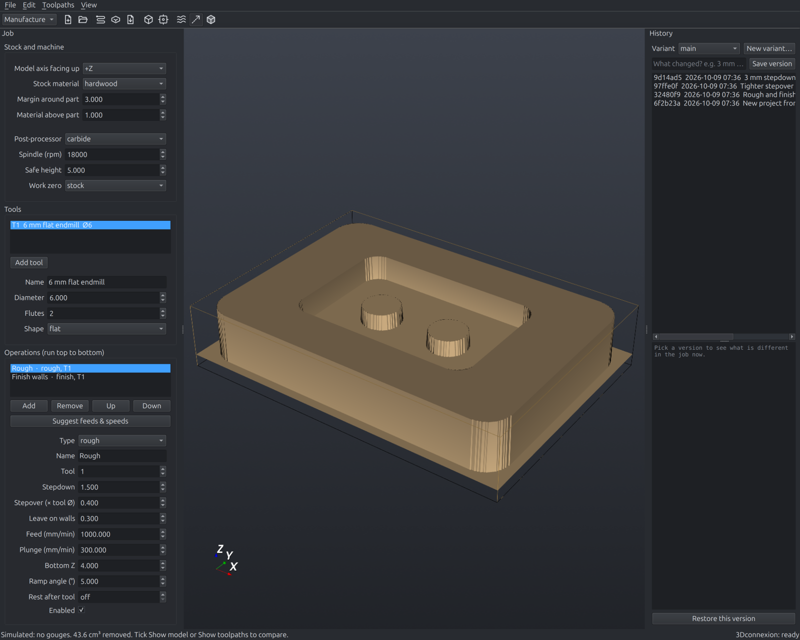

The stock is a height map. Every feed move stamps the tool into it, and the result is
compared with a height map of the part, so a toolpath that would cut into the part is
reported and drawn red. Lateral accuracy is a quarter of the grid size (0.25 mm grid by
default).

### G-code

Two posts, both mm and absolute, with `G0`/`G1` moves and `G2`/`G3` arcs where a run of
short moves fits one within 5 µm (turn arcs off with `arcs = false`):

| Post | For | Tool change | Safe retract | End |
|---|---|---|---|---|
| `carbide` (default) | Shapeoko, Nomad with Carbide Motion | `M6 T<n>` for every tool, so Carbide Motion prompts and a BitSetter re-measures | `G53 G0 Z-5` before tool changes and at both ends | `M2` |
| `grbl` | any GRBL 1.1 machine | `M0` pause, re-zero Z by hand | none | `M30` |

The `carbide` post follows Carbide Create's own `shapeoko.post`, including the CutViewer
`STOCK/BLOCK` and `TOOL/MILL` comments. Work zero is the stock's front-left top corner by
default (`zero = "model"` uses the CAD origin).

### Send to phobiCCCP

CAM beyond this lives in [phobiCCCP](https://github.com/phobicdotno/phobiCCCP). File →
*Send to phobiCCCP…* (or `syntexophobic send <project> [host[:port]]`) sends the open project
to a phobiCCCP running on this computer, the local network (found by itself) or over Tailscale
(type its Tailscale name or address): the part as an STL placed on the stock, every XY sketch
as a DXF and the whole project folder with its history as a `.cccp` file. phobiCCCP asks
before it opens it as a new design, with the part as its 3D model. The link uses port 47652
(TCP, and UDP for finding phobiCCCP); the protocol is described in `send.py`.

### Compute backends

Slicing and simulation run through a pluggable backend with a numpy-compatible API:
`numpy` on the CPU always works, `cupy` is used automatically for NVIDIA CUDA (install the
`cuda` extra) or AMD ROCm builds of CuPy. Choose with `--backend` or
`SYNTEXOPHOBIC_BACKEND`. Other GPU stacks register a factory in `compute.BACKENDS`.

## Not there yet

Scallop finishing. See
[CHANGELOG.md](CHANGELOG.md) for what changed.

Screenshots are made from `examples/demo-plate.step` and a small designed bracket by
`uv run python tools/screenshots.py`.
